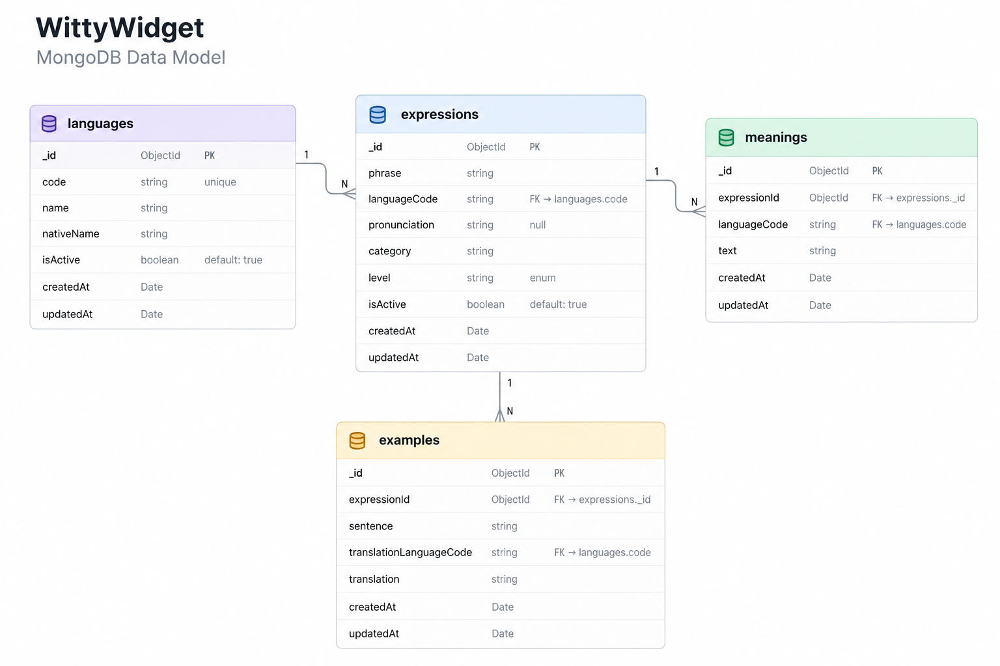

<h1 align="center">
  WittyWidget Server
</h1>

<p align="center"><em>A little English, every day.</em></p>

<div align="center">
  
  
  
  
  
  
  <br>
  
</div>

<!-- TODO: Adicione aqui o vídeo/GIF de demonstração quando estiver disponível. -->
<!-- Exemplo: <p align="center"></p> -->

## Objetivo do projeto

O **WittyWidget Server** é a API do WittyWidget, um aplicativo de microaprendizado que apresenta uma expressão em inglês por dia, com significado em português e exemplos de uso. A proposta é facilitar o contato diário com o idioma por meio de uma experiência rápida, que futuramente também será exibida em um widget nativo para Android.

Esta é a primeira versão do backend. A API foi construída com Node.js, TypeScript, Express e MongoDB, utilizando Mongoose para modelagem e persistência dos documentos. O projeto segue uma organização MVC simples, com controllers, routes, models, validators e middlewares. O foco inicial é fornecer o catálogo de expressões e a publicação diária que será consumida pelo aplicativo mobile.

## Funcionalidades

- Cadastro e listagem de idiomas.
- Cadastro e listagem de expressões, com significado, tradução de exemplo, categoria e nível.
- Endpoint para consultar a expressão do dia.
- Registro persistente da publicação diária no MongoDB.
- Validação de dados de entrada com Zod.
- Chave administrativa para proteger as rotas de criação de conteúdo.
- Cache em memória para respostas da expressão diária e cabeçalhos HTTP de cache.
- Documentação interativa da API com Swagger UI.

> **Escopo da primeira versão:** o conteúdo inicial é voltado ao aprendizado de inglês com traduções em português brasileiro. A modelagem foi preparada para permitir a inclusão de outros idiomas futuramente. O backend não possui autenticação de usuários; a chave administrativa protege as operações de escrita.

## Tecnologias

| Tecnologia           | Uso                                      |
| -------------------- | ---------------------------------------- |
| Node.js              | Ambiente de execução do backend          |
| TypeScript           | Tipagem estática e organização do código |
| Express              | Criação das rotas HTTP                   |
| MongoDB Atlas        | Banco de dados em nuvem                  |
| Mongoose             | Schemas, models e acesso aos documentos  |
| Zod                  | Validação dos dados de entrada           |
| Swagger UI / OpenAPI | Documentação interativa da API           |
| dotenv               | Configuração por variáveis de ambiente   |

## Arquitetura

O projeto utiliza uma estrutura MVC enxuta. As rotas encaminham as requisições aos controllers; os controllers validam os dados, utilizam os models do Mongoose e retornam respostas HTTP em JSON. A validação de entrada fica em arquivos separados e o middleware administrativo protege as operações de escrita.

```text
WittyWidgetServer/
├── scripts/
│   └── seed.ts
├── src/
│   ├── config/
│   │   └── database.ts
│   ├── controllers/
│   │   ├── daily-publication.controller.ts
│   │   ├── expression.controller.ts
│   │   └── language.controller.ts
│   ├── docs/
│   │   └── openapi.ts
│   ├── middlewares/
│   │   └── require-admin-key.ts
│   ├── models/
│   │   ├── daily-publication.model.ts
│   │   ├── expression.model.ts
│   │   └── language.model.ts
│   ├── routes/
│   │   ├── expression.routes.ts
│   │   └── language.routes.ts
│   ├── utils/
│   │   └── memory-cache.ts
│   ├── validators/
│   │   ├── daily-publication.validator.ts
│   │   ├── expression.validator.ts
│   │   └── language.validator.ts
│   ├── app.ts
│   └── server.ts
├── .env.example
├── package.json
└── tsconfig.json
```

_Nota: a estrutura acima representa a organização prevista para a primeira versão. Atualize a árvore caso os nomes ou arquivos mudem durante o desenvolvimento._

<!-- TODO: Adicione uma captura de tela do diagrama de arquitetura ou trechos de código exportados pelo Carbon. -->
<!-- Exemplo:  -->

## Banco de dados

O banco utiliza MongoDB com três models principais:

- **Language:** representa os idiomas disponíveis, identificados por um código como `en` ou `pt-BR`.
- **Expression:** armazena a expressão, o idioma original, os significados, os exemplos, a categoria, o nível e o status ativo.
- **DailyPublication:** registra qual expressão foi selecionada para uma data e um idioma. Um índice único em `dateKey` e `languageCode` impede mais de uma publicação para a mesma combinação.

O script `scripts/seed.ts` insere idiomas e expressões iniciais para desenvolvimento. Ele pode ser executado novamente para atualizar esses registros de exemplo sem criar novas cópias para as mesmas combinações.

<h2 align="center">Database Modeling</h2>

<p align="center">
  
</p>

## Expressão do dia e cache

O endpoint de expressão diária utiliza o fuso horário `America/Sao_Paulo` para calcular a data de referência. Quando ainda não existe uma publicação para a data e o idioma solicitados, o backend seleciona uma expressão elegível e registra a escolha em `DailyPublication`. As requisições seguintes recuperam a publicação salva, em vez de escolher uma nova expressão a cada chamada.

A resposta também utiliza cache em memória e cabeçalhos HTTP. O cache em memória é temporário e específico do processo do servidor; ele é perdido quando o processo reinicia. A publicação em si permanece registrada no MongoDB.

> **Limitação atual:** a publicação é criada sob demanda, na primeira requisição do dia. A primeira versão ainda não agenda a criação exatamente à meia-noite. A atualização visual do futuro widget Android também dependerá das regras de execução em segundo plano do sistema operacional.

## Documentação da API

Com o servidor em execução localmente, acesse a interface Swagger UI:

- **Swagger UI:** `http://localhost:3000/api-docs/`
- **Health check:** `http://localhost:3000/health`

A documentação descreve os endpoints, parâmetros e corpos das requisições disponíveis nesta versão. Para manter a especificação confiável, atualize `src/docs/openapi.ts` sempre que modificar as rotas ou os formatos de resposta.

## Endpoints disponíveis

| Método | Endpoint                    | Acesso         | Descrição                                                     |
| ------ | --------------------------- | -------------- | ------------------------------------------------------------- |
| `GET`  | `/health`                   | Público        | Verifica se a API está respondendo                            |
| `GET`  | `/api/v1/languages`         | Público        | Lista idiomas ativos                                          |
| `POST` | `/api/v1/languages`         | Administrativo | Cadastra um idioma                                            |
| `GET`  | `/api/v1/expressions`       | Público        | Lista expressões; aceita filtros de idioma, nível e categoria |
| `POST` | `/api/v1/expressions`       | Administrativo | Cadastra uma expressão                                        |
| `GET`  | `/api/v1/expressions/today` | Público        | Retorna a expressão diária e sua tradução                     |

A chave administrativa é enviada pelo cabeçalho `x-admin-key`. Ela deve ser mantida em uma variável de ambiente no servidor e nunca deve ser incluída no aplicativo React Native ou commitada no repositório.

### Exemplo: consultar a expressão do dia

```bash
curl "http://localhost:3000/api/v1/expressions/today?language=en&locale=pt-BR"
```

Exemplo de resposta:

```json
{
  "date": "2026-10-18",
  "timeZone": "America/Sao_Paulo",
  "language": "en",
  "locale": "pt-BR",
  "expression": {
    "id": "EXPRESSION_ID",
    "phrase": "Take it easy",
    "pronunciation": null,
    "meaning": "Relaxe, fique tranquilo.",
    "example": {
      "sentence": "Take it easy this weekend.",
      "translation": "Relaxe neste fim de semana."
    },
    "category": "everyday",
    "level": "beginner"
  }
}
```

_O conteúdo acima é ilustrativo; a resposta real depende dos documentos presentes no banco._

## Segurança

- As rotas de escrita exigem a chave administrativa configurada em `ADMIN_API_KEY`.
- A chave é enviada no cabeçalho `x-admin-key`; não a inclua em URLs, capturas de tela públicas ou no frontend mobile.
- Credenciais e segredos devem permanecer no `.env`, que não deve ser versionado.
- As rotas públicas são somente de leitura e disponibilizam o conteúdo necessário ao aplicativo.

A chave administrativa é uma proteção simples para a primeira versão, não um sistema completo de identidade ou gerenciamento de usuários. Antes de disponibilizar a API publicamente, revise a configuração de HTTPS, limites de requisição e acesso às rotas administrativas.

## Como executar localmente

### Pré-requisitos

- Node.js 22 ou compatível.
- npm.
- Uma instância MongoDB Atlas ou MongoDB acessível pelo ambiente de desenvolvimento.

### 1. Clone o repositório

```bash
git clone <URL_DO_REPOSITORIO>
cd WittyWidgetServer
```

### 2. Instale as dependências

```bash
npm install
```

### 3. Configure as variáveis de ambiente

Crie um arquivo `.env` na raiz do projeto. Use o `.env.example` como referência:

```env
PORT=3000
MONGODB_URI=mongodb+srv://<usuario>:<senha>@<cluster>/<database>
ADMIN_API_KEY=gere-uma-chave-aleatoria-e-mantenha-aqui
```

Substitua os valores pelos dados do seu ambiente. Não compartilhe nem versione o arquivo `.env`.

### 4. Popule os dados iniciais

```bash
npm run seed
```

O seed cria ou atualiza os idiomas e as expressões de exemplo necessários para testar a API.

### 5. Execute em desenvolvimento

```bash
npm run dev
```

Por padrão, a API estará disponível em `http://localhost:3000`.

### 6. Verifique a compilação

```bash
npm run typecheck
npm run build
```

Para iniciar a versão compilada, use `npm start`.

## Scripts disponíveis

| Comando             | Descrição                                    |
| ------------------- | -------------------------------------------- |
| `npm run dev`       | Executa o servidor em desenvolvimento        |
| `npm run typecheck` | Verifica os tipos TypeScript                 |
| `npm run build`     | Compila o projeto TypeScript                 |
| `npm start`         | Inicia a versão compilada                    |
| `npm run seed`      | Insere ou atualiza dados iniciais no MongoDB |

---

<p align="center"><em>WittyWidget — A little English, every day.</em></p>
